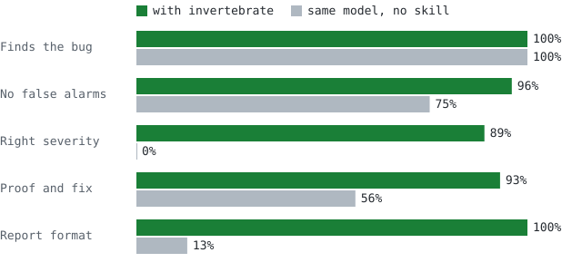

# Invertebrate

A [Claude Code](https://claude.com/claude-code) skill for AI code review in the style of [Greptile](https://www.greptile.com). Before judging a change, it traces every changed function, type, and route through the **whole repository**. That catches bugs that reading the diff alone misses: a rename that leaves callers broken, a unit change (cents → dollars) that some callers never picked up, a new endpoint missing the auth check that its sibling endpoints all have, or a "cleanup" that deletes a line an earlier commit added to fix a bug.

Because it runs locally, it can also **prove** what it finds. Each serious finding comes with a test that fails on the PR's code, or a compiler error. A finding it can't reproduce is dropped. When you ask it to fix a finding, it reruns that test to confirm the fix.

Not affiliated with or endorsed by Greptile.

<p align="center"></p>

<p align="center">
  <strong>Same bugs found. False alarms avoided: 96% vs 71%. Critical bugs labeled P0: 100% vs 0%. Repro tests and fixes: 93% vs 56%.</strong><br>
  <sub>Invertebrate 1.4, 11 seeded-bug repos, 3 runs each, Claude Code + Opus 5.5, the same model with and without the skill. Costs about 2x a plain review. <a href="#numbers">Details</a>.</sub>
</p>

Works in Claude Code, Codex, GitHub Copilot CLI, Gemini CLI, Antigravity, and more agents. See [Install](#install).

## Install

**Claude Code** (2.1.275 or later), in your terminal:

```bash
claude plugin install invertebrate --marketplace sedricedwards/invertebrate
```

Or inside a session: `/plugin install invertebrate --marketplace sedricedwards/invertebrate`. Update with `claude plugin update invertebrate`, remove with `claude plugin uninstall invertebrate`.

**Codex:**

```bash
codex plugin marketplace add sedricedwards/invertebrate
codex plugin add invertebrate@sedricedwards
```

**Gemini CLI:**

```bash
gemini extensions install https://github.com/sedricedwards/invertebrate
```

**Any other agent:** Copilot CLI, Antigravity, Devin, Grok, Goose, Kimi, Qoder, pi, OpenCode, Cursor, Cline and the rest are covered in **[INSTALL.md](INSTALL.md)**. If your agent isn't listed, copy the `skills/invertebrate/` folder into its skills folder (see INSTALL.md).

Invertebrate is one prompt, [`skills/invertebrate/SKILL.md`](skills/invertebrate/SKILL.md), plus two stdlib Python helpers. Every other file at the repo root just tells a particular agent where that folder is.

## Use

The skill runs **only** when your message contains the word "invertebrate":

```
invertebrate review PR #12
run invertebrate on my branch
invertebrate review my uncommitted changes
invertebrate review PR #12 and post it
invertebrate re-review PR #12
invertebrate learn
```

Accepted targets are a PR number or URL (needs the `gh` CLI), a branch (compared against main/master), the working tree, or a `.diff`/`.patch` file.

## Output

Everything is color-coded and labeled in plain words, so people who don't write code can read it too.

- **Verdict**: "Safe to merge? Yes / After small fixes / Not yet / No", plus one sentence on the biggest problem
- **Summary**: what the change does and its main risk, in plain language
- **Confidence score**: 0–5 with a traffic-light color and meter, e.g. `🟡 3/5 ●●●○○` (🟢 5–4 = merge, 🟡 3 = fix first, 🟠 2 = rework, 🔴 0–1 = rethink)
- **Findings table**: each finding's severity (🔴 P0 Critical / 🟠 P1 High / 🟡 P2 Medium), type (Bug / Won't compile / Cleanup), proof, and location
  - Proof is one of: Proven by test (a test it wrote and ran failed), Proven by build (compiler/typecheck error), Found by search (for example a surviving reference to a removed symbol), or Unproven
  - Unproven P0/P1 findings are demoted one level
- **Diagram**: mermaid sequence, ER, class, or flow diagram, chosen to fit the change; skipped for trivial diffs. It's drawn as a picture on GitHub and in the visual report; in the terminal you see its source
- **Inline comments**: the concrete failure scenario, a suggested-fix diff, and the repro test so you can run it yourself
- **Since last review** (re-reviews only): each earlier finding marked ✅ resolved / ⚠️ open / 🔴 regressed, and the score across reviews (e.g. `1/5 → 2/5 → 4/5`). Only new findings get new comments

### Visual report

After a review, say `html` and Invertebrate writes a self-contained HTML page to your temp folder and opens it: the colored verdict, a bar chart of findings by severity, a chart of the score across reviews, the diagram drawn as a picture, and one color-coded card per finding. It needs Python. The page is one small file (about 25 KB) that works offline and loads nothing from the internet; the charts and diagram are drawn by code built into the page.

### Proving findings

Invertebrate runs the project's build/typecheck if the tool is already installed, and runs a short repro test for each candidate bug, then deletes those tests. It never installs dependencies or uses the network for this. For a PR it uses a separate git worktree and leaves your checkout alone. It asks first if the PR was opened by someone else, because running it runs their code.

### Re-reviews

Each review ends with a hidden `<!-- invertebrate:sha=... -->` marker. On the next run against the same PR (or a saved review you point to), Invertebrate reviews only the commits since then and rechecks the earlier findings. After a force-push it falls back to a full review.

### Learn mode

`invertebrate learn` reads review comments on your last 30 merged PRs. It proposes rules for concerns the team accepted at least twice, and "don't flag" instructions for ones the team rejected at least twice. Each proposal links its PRs as evidence. Nothing is written until you say `save them`; then the rules go into `.invertebrate/`.

Posting to GitHub happens only when you ask (`post it`, `--post`). The review is posted as a single `COMMENT` review and never approves or requests changes.

## Configuration

You can add an optional `.invertebrate/` folder to your repo, at the root or in any subdirectory. Invertebrate only reads it; the one exception is learn mode, and only after you say `save them`. Settings in a subfolder's `.invertebrate/` apply to changes in that part of the repo.

Already using Greptile? Invertebrate reads your existing `.greptile/` folder as is, since the format is the same. If a directory has both folders, `.invertebrate/` wins.

| File | Purpose |
|---|---|
| `config.json` | `strictness` 1–3, `commentTypes`, `ignorePatterns`, `instructions`, scoped `rules` with severity |
| `rules.md` | Plain-English team rules |
| `files.json` | Extra files to read as context |

Example `.invertebrate/config.json`:

```json
{
  "strictness": 2,
  "rules": [
    { "id": "audit-mutations", "rule": "Every endpoint that changes data must call audit_log().", "scope": ["app/**/*.py"], "severity": "high" }
  ]
}
```

If there's no config folder at all, it uses `CLAUDE.md` / `AGENTS.md` / `CONTRIBUTING.md` as the rules.

## Tests

`evals/` contains 11 seeded-bug sample projects: a cross-file rename, a semantic unit change, a missing auth check under strictness 3, an async race, a PR that claims a security fix it doesn't deliver, a clean PR that should get no findings, and a repo with both `.invertebrate/` and `.greptile/` to check that `.invertebrate/` wins. Four more cover the newer features:

- `repro-then-fix`: the bug must be proven with a test that was actually run, a decoy the caller already handles must not be reported, and the fix must be confirmed by rerunning the repro
- `reverted-fix`: the PR deletes a guard that a commit titled "Fix double charge…" added, and the review must cite that commit
- `alias-reexport-distractors`: the broken callers are reachable only through `import { x as y }` and a re-export, among 30 unrelated callers of a function with the same name
- `incremental-rereview`: a second review of a branch must mark the old finding resolved and report only the new bug

Learn mode has no case, because it needs a live GitHub repository. To run them:

```bash
git clone https://github.com/sedricedwards/invertebrate && cd invertebrate
claude plugin eval . --allow-tools Write,Edit,Bash --scaffold
```

These are real, billed model runs.

To turn your runs into the numbers below and redraw `assets/benchmark.svg`, run `python evals/summarize.py`. It uses the newest with/without run of each case.

## Numbers

Each case is a small repo with a planted bug (or none), reviewed by Claude Code on Opus 5.5 three times **with** the skill and three times **without** it (the same model, given the same prompt). LLM judges score each review against 4–6 written checks. The table groups those checks by what they test.

| Check | With Invertebrate | No skill |
|---|--:|--:|
| Finds the planted bug | **100%** (66/66) | 100% (66/66) |
| No false alarms (doesn't flag decoys, filtered rules, or a clean PR) | **96%** (23/24) | 71% (17/24) |
| Right severity (a critical bug is labeled P0) | **100%** (18/18) | 0% (0/18) |
| Proof and fix (repro test run, suggested-fix diff, fix verified) | **93%** (25/27) | 56% (15/27) |
| Report format (confidence score, findings table, diagram, re-review table) | **100%** (45/45) | 13% (6/45) |
| Cases where every run passed every check | **9/11** | 0/11 |
| Median cost per review | $0.37 | $0.18 |
| Median time per review | 91 s | 61 s |
| Median agent turns | 8 | 4 |

How to read this:

- **It doesn't find more bugs on these cases.** Opus 5.5 on its own caught every planted bug. The skill adds the things that decide whether a team keeps a reviewer turned on: no crying wolf, the right severity, and a test that proves the bug.
- **"Right severity" is partly a format check.** Without the skill the model never uses P0/P1 labels, so it scores 0 there even when it calls a bug "high severity". The severity checks also require P0 rather than P1 for security and data-loss bugs.
- **It costs more.** Building the context graph and running repro tests takes about twice the turns. The median review costs $0.19 more and takes 30 s longer.
- **Where it still misses:** in `repro-then-fix`, 1 of 3 runs left a repro file behind, and its proof label didn't match a test that actually ran. In `invertebrate-config-wins`, 1 of 3 runs mentioned the overridden `.greptile/` docstring rule while explaining why it wasn't applied, and 2 of 3 judges counted that as a false alarm.
- **Measured on 1.4.0** (2026-11-06). On 1.4.0, 2 of 3 `invertebrate-config-wins` runs rated an "anyone can cancel anyone's order" hole as P1 instead of P0. 1.4.1 adds one sentence to the severity rule (a missing auth or ownership check is always P0), and that case was re-run on 1.4.1: 3 of 3 rated it P0. The other 10 cases are from 1.4.0. Inside the eval sandbox the skill couldn't run its `context.py` helper and traced references with grep instead, so these numbers don't include the helper's speedup.

Run it yourself: `claude plugin eval . --ablation with-without --allow-tools Write,Edit,Bash --scaffold`, then `python evals/summarize.py`. These are real, billed model runs, about $19 for the full suite.

## Before / after

A real pair of runs on 1.4.0 from the `invertebrate-config-wins` case. The PR adds `cancel_order` without the ownership check or the `audit_log()` call that its sibling `update_address` has. The repo has both an `.invertebrate/` config (strictness 3, an audit rule) and a `.greptile/` config (strictness 1, a docstring rule).

<table>
<tr><th width="50%">Same model, no skill</th><th width="50%">With Invertebrate</th></tr>
<tr><td valign="top">

> My verdict is **request changes**: the new `cancel_order` function has two serious problems.
> 1. **Missing audit log** (breaks the `audit-order-changes` rule) …
> 2. **No ownership check:** … anyone can cancel any order if they know its ID.
> 3. **Minor:** it doesn't look at the order's current status before cancelling … also raises a plain `KeyError` …
>
> … `.greptile/config.json` … wasn't enforced, but my suggested fix adds a docstring anyway.

</td><td valign="top">

> **It's not safe to merge (1/5).** … both proven by tests that failed on the current code.
>
> | # | Severity | Location | Issue |
> |---|---|---|---|
> | 1 | 🔴 P0 Critical | `app/orders.py:15` | There's no ownership check, so any user can cancel anyone's order. |
> | 2 | 🟠 P1 High | `app/orders.py:17` | It never calls `audit_log()`, which breaks the high-severity `audit-order-changes` rule. |
>
> Each finding in the review includes a short code fix and the test that proves it.

</td></tr>
<tr><td valign="top">Both bugs found, but the auth hole sits next to the missing audit line with no ranking, nothing is proven, and it adds noise that strictness 3 should filter out.</td><td valign="top">The auth hole is P0, both bugs are proven by a test that ran, and the rule the team overrode stays quiet.</td></tr>
</table>

## Not included

- Learning live from 👍/👎 reactions (learn mode proposes rules from past PRs instead)
- Automatic review of every PR (it runs on request only)

## Privacy and external services

Invertebrate declares no connectors. It contacts one outside service, **GitHub**, through the GitHub CLI (`gh`), signed in as you:

| When | What is sent to GitHub |
|---|---|
| You give a PR number or URL | Requests for that PR's title, description, file list and diff (read only) |
| You explicitly ask to post the review | The review text and inline comments, posted to that PR as a `COMMENT` review |
| You re-review a PR | A request for that PR's earlier reviews (read only) |
| You run `invertebrate learn` | Requests for your recent merged PRs and their review comments (read only) |

It contacts no other service, and it collects and stores nothing. See the [Privacy Policy](PRIVACY.md).

## License

MIT
